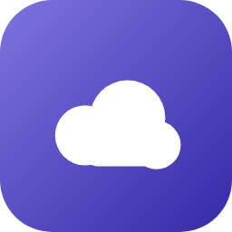

# 国内外 AI 模型聚合服务平台调研（2026-10）

覆盖 **中国大陆 20 项 + 海外 21 项** AI 模型聚合 / 开放平台（模型 API 托管与路由、统一接入多模型），四类全覆盖：聚合路由平台、云厂商开放平台、模型厂商开放平台、推理与算力平台。

## 文件说明

| 文件 | 内容 |
|---|---|
| `index.html` | 报告首页入口（GitHub Pages 根页面） |
| `中国AI模型聚合平台产品调研2026.html` | 国内 20 项平台完整调研 |
| `海外AI模型聚合平台产品调研报告.html` | 海外 21 项平台完整调研 |

## 数据口径

- 信息获取时间：2026-10-08（北京时间）
- 评分：10 分制主观共识分，综合官方文档、科技媒体评测、第三方横测与开发者社区口碑；维度为模型覆盖面、统一接入与路由能力、价格与免费额度性价比、限流与稳定性、文档与开发者体验（云平台另看企业治理与区域）。`basis` 字段首句标注共识区间；跨品类不宜直接横向比较
- 价格：国内人民币（每百万 tokens，输入 / 输出分列）；海外 USD 原值 + `cny` 字段按 1 USD≈7.1 CNY 约合（量级参考）
- 免费额度与价格为官方口径，无法核实标"待确认"

## 快速结论

- 国内第一梯队：阿里云百炼（8.6）、火山方舟（8.5）、DeepSeek 开放平台（8.5）、智谱 AI（8.4）、腾讯云 TokenHub / MiniMax（8.2）
- 海外第一梯队：OpenAI Platform（8.9）、Anthropic Console（8.7）、Google AI Studio（8.5）、OpenRouter（8.4）、Amazon Bedrock（8.3）
- 免费额度正在收口：国内大厂把「永久免费」改为 90 天 / 首购一次性；海外 Replicate、Fireworks 仅一次性试用额度，SambaNova 已取消免费额度
- 价格分层：海外前沿旗舰 $2–5 输入档 vs 开源托管 $0.05–0.75 档；国内自研旗舰 6–12 元输入档 vs 开源托管 2–4 元档

## 重要核验（已列入排除清单）

- 零一万物大模型开放平台：官方公告逐步停止自助 API 服务（已停服）
- OctoAI：2024-09 被 NVIDIA 收购，2024-10-31 终止全部托管端点
- Hugging Face Inference API（旧形态）：已升级为 Inference Providers，按 provider 结算
- SambaNova Cloud：$5 新用户免费额度已取消；Groq 的 Llama 系列与 MiniMax M2.7 已转 Enterprise 定价
- 腾讯云大模型知识引擎（LKE）、昆仑万维天工 / SkyProduction、智谱清言：非模型 API 聚合平台
- 第三方 API 中转站（如 API易等）：非官方渠道，不作为官方依据

## 免责

价格、免费额度与限流策略变动频繁，正式采购前请以厂商官方页面与控制台实时口径为准。本报告评分为主观共识评分，非厂商官方指标。
